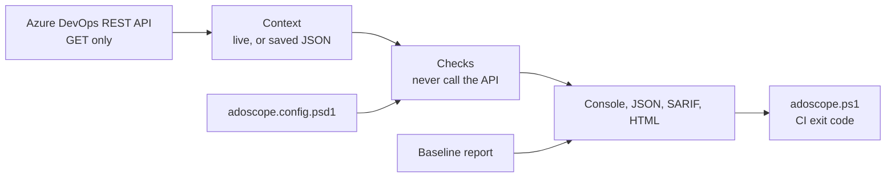

# adoscope

[](https://github.com/cescomar/adoscope/actions/workflows/ci.yml)
[](CHANGELOG.md)
[](LICENSE)

Read-only security and governance audit for **Azure DevOps Services** organizations.

adoscope reads the configuration of an organization through the REST API and reports
what is risky, wasteful or abandoned: credentials open to every pipeline, secrets
stored in plain text, production environments without approvals, branches without
review, full-access personal access tokens, outdated agents, unused paid licenses.
Every finding explains **why it matters** and **how to fix it**, and every security
check is mapped to the [OWASP Top 10 CI/CD Security Risks](https://owasp.org/www-project-top-10-ci-cd-security-risks/).

```
adoscope 0.3.0 - organization 'fabrikam' - data collected 2026-11-28T09:12:44.3217720Z (Live), 12 project(s)

Critical (1)
  [SEC011] Credential stored as a plain-text variable in a pipeline definition: payments/deploy
      Not marked secret: RegistryToken (value matches a credential format).

High (2)
  [SEC001] Service connection authorized for all pipelines: payments/azure-prod
      Service connection 'azure-prod' (type azurerm) is open to every pipeline in the project.
  [IAM006] Personal access token with full access: jane@fabrikam.com/release-script
      Token 'release-script' of jane@fabrikam.com has full access; valid until 2027-02-01.

Coverage gaps (1)
  [AGT001] NotEvaluated: Not configured: set Checks.Parameters.AGT001.trustGroups in the config, or disable AGT001.

Summary - Critical: 1, High: 2, Medium: 0, Low: 0, Info: 0 | suppressed: 0 | checks: 32/33 fully evaluated
```

## Why it is safe to run

- **GET only, by construction.** One HTTP client rejects every other method and sends
  credentials only to Azure DevOps hosts. No redirects are followed.
- **No secrets in output.** Variable values are discarded at collection time, pipeline
  definitions are reduced to the fields checks use, and personal access tokens are read
  as metadata only. Even a saved context holds no credentials; tokens are never printed
  and are redacted from errors.
- **Nothing leaves your machine.** No telemetry, no third-party calls.
- **Honest coverage.** Data that cannot be read (for example a 403) makes the affected
  checks *NotEvaluated* or *Partial*, never clean, and the report names the API that
  failed and the checks it weakens. A check that is not configured is not counted as
  passed either.

## What it checks

33 checks. Full list with rationale, remediation, data source, OWASP mapping and
parameters: **[docs/checks.md](docs/checks.md)**.

| Area | Examples |
|---|---|
| Credentials | plain-text secrets in variable groups, pipeline and classic release variables; service connections, secret variable groups and secure files open to every pipeline; client secrets instead of workload identity federation |
| Pipelines | production environments and classic release stages without approvals; release creators approving their own deployments; required template missing; fork PR builds with secrets; weakened pipeline security settings; classic pipelines |
| Code and extensions | default branches without required reviewers; public projects; third-party extensions with write or execute scopes |
| Identity | too many collection or project administrators; inactive administrators; guest administrators; organization not connected to Microsoft Entra ID; personal access tokens with full access, long lifetimes or valid in all organizations |
| Agents | self-hosted pools shared across trust groups; outdated or long-offline agents |
| Hygiene, cost, reliability | pipelines and repositories unused for months; paid licenses of inactive users; pipelines that fail too often |

## How it works



Collection and analysis are separate: collect once, then re-run the checks offline on the
saved context. Reports record when the data was collected, whether the run was live or
offline, and which projects it covered, so old data never reads as a fresh audit.

## Quick start

Requires PowerShell 7.2+ on Windows, Linux or macOS. No other dependencies.

```powershell
git clone --branch v0.3.0 --depth 1 https://github.com/cescomar/adoscope.git
Import-Module ./adoscope/adoscope.psd1

# Credentials, first match wins: -AccessToken, -Pat, $env:AZURE_DEVOPS_EXT_PAT,
# Azure CLI (az login) or Az PowerShell session, $env:SYSTEM_ACCESSTOKEN.
az login
Invoke-AdoScope -Organization fabrikam

# Reports for people and tools
Invoke-AdoScope -Organization fabrikam -HtmlPath ./adoscope.html -SarifPath ./adoscope.sarif -JsonPath ./adoscope.json

# Collect once, analyze offline (the file holds org data and user e-mails: keep it private)
Invoke-AdoScope -Organization fabrikam -SaveContextPath ./context.json
Invoke-AdoScope -ContextPath ./context.json -ConfigPath ./adoscope.config.psd1
```

| Output | For |
|---|---|
| Console | findings by severity, data not fully read, coverage gaps, summary |
| HTML (`-HtmlPath`) | one self-contained file with filters by category and severity; shareable |
| SARIF 2.1.0 (`-SarifPath`) | GitHub code scanning and other SARIF viewers; stable fingerprints, OWASP tags |
| JSON (`-JsonPath`) | automation, and the baseline for the CI gate |

Projects are collected 4 at a time by default (`-ThrottleLimit 1..16`). Expired Azure CLI /
Az tokens are renewed automatically during long audits.

**Permissions.** The identity needs read access to what is audited. Organization-wide
data (agent pools, user licenses, administrator groups, personal access tokens) and
pipeline permissions usually require Project Collection Administrator or equivalent
read rights. Whatever it cannot read is listed with the API called and the checks
affected, instead of passing silently.

## Use in CI

`adoscope.ps1` wraps the module with exit codes for pipelines:

| Exit | Meaning |
|---|---|
| 0 | No unsuppressed finding at or above `-FailOn` (default `High`), full coverage |
| 1 | Findings at or above `-FailOn` |
| 2 | Some checks could not be evaluated: data unreadable, or a check not configured such as AGT001 without `trustGroups` (configure or disable it, or use `-AllowIncompleteCoverage`) |
| 3 | The audit failed (authentication, configuration, network) |

**Adopting the gate on an organization with existing findings.** Save today's report
once and use it as a baseline: the build fails only on findings that are *new*.

```powershell
./adoscope.ps1 -Organization fabrikam -JsonPath ./baseline.json -FailOn None   # once
./adoscope.ps1 -Organization fabrikam -BaselinePath ./baseline.json            # every run
```

A known finding counts as *resolved* only when the run could have seen it (check fully
evaluated, project in scope, same parameters). One that vanished because of a 403, a
narrower scope or a changed threshold is reported as *unverified*, never as fixed.

**Azure Pipelines:** [templates/azure-pipelines.yml](templates/azure-pipelines.yml) runs a
weekly audit with a workload identity federation service connection, fetches adoscope by
the commit SHA of a release, applies your config and baseline, and publishes JSON, SARIF
and HTML reports as a pipeline artifact. Copy it into a private repository next to
`adoscope.config.psd1`.

**GitHub Actions**, with a read-only PAT stored as a secret:

```yaml
- run: ./adoscope.ps1 -Organization fabrikam -SarifPath adoscope.sarif
  shell: pwsh
  env:
    AZURE_DEVOPS_EXT_PAT: ${{ secrets.ADO_READ_PAT }}
```

### Operating it safely

- **Pin what runs.** Use a released version, not `main`; the template pins the commit SHA
  of a release (a tag can be moved, a SHA cannot). Change the pin through a reviewed pull
  request.
- **Review what changes the gate.** `adoscope.config.psd1`, the baseline and suppressions
  decide what fails the build: keep them in the repository, change them only through
  reviewed pull requests (for example with a CODEOWNERS entry), and never regenerate the
  baseline automatically, or new findings get accepted silently.
- **Treat outputs as confidential.** Reports, saved contexts and logs contain user names
  and e-mails, resource names and configuration details (never secret values). Keep them
  in private repositories or artifacts with restricted access and a retention limit
  (Azure Pipelines artifact retention, GitHub Actions `retention-days`).
- **Use a dedicated audit identity**, preferably with workload identity federation,
  rather than a person's account.

## Configuration

Optional `adoscope.config.psd1` (PowerShell data file: comments allowed, never executed):

```powershell
@{
    Organization = 'fabrikam'
    Projects     = @('payments', 'web')        # default: all projects
    Checks       = @{
        Disabled   = @('HYG002')
        Parameters = @{
            HYG001 = @{ days = 60 }
            # AGT001 is NotEvaluated until it knows which projects trust each other.
            AGT001 = @{ trustGroups = @{ production = @('payments'); sandbox = @('playground') } }
        }
        Severity   = @{ PIP003 = 'Medium' }
    }
    Suppressions = @(
        # Fingerprint from a JSON/SARIF report. Reason and Expires are mandatory.
        @{ Check = 'SEC001'; Fingerprint = '<sha256>'; Reason = 'Accepted until WIF migration (CHG-1234)'; Expires = '2026-12-31' }
    )
}
```

Mistakes are errors, raised before any API call: unknown keys, checks or parameters, and
invalid values (negative days, a project in two trust groups, a version that is not a
version). Expired suppressions stop applying and are reported; suppressions that no
longer match anything are reported too, so exceptions do not pile up.

## Development

```powershell
Install-Module Pester -MinimumVersion 5.5 -MaximumVersion 5.99.99 -Scope CurrentUser
Install-Module PSScriptAnalyzer -Scope CurrentUser
./build.ps1                    # PSScriptAnalyzer + Pester with coverage floor, same as CI
./tools/Update-CheckDoc.ps1    # regenerate docs/checks.md after changing a check
```

- Architecture, data model and every design decision: [SPEC.md](SPEC.md). Release
  history: [CHANGELOG.md](CHANGELOG.md).
- A check is one file, `src/Checks/<Category>/<ID>.ps1`: metadata (severity, rationale,
  remediation, OWASP mapping, parameters) and a `Test` script block that reads the
  collected context. Checks never call the API.
- Tests run offline on synthetic fixtures (`tests/Fixtures`); CI runs them on Windows,
  Linux and macOS.
- Live testing: `lab/Initialize-AdoScopeLab.ps1 -Organization <org>` creates a
  disposable `adoscope-lab` project with resources the checks must and must not flag.
  It is the only script that writes to an organization; delete the project to clean up.
  `lab/Test-AdoScopeLab.ps1` (read-only) verifies that adoscope finds exactly the
  expected issues; the `lab` workflow can run it nightly once the `ADO_LAB_READ_PAT`
  secret and `ADO_LAB_ORGANIZATION` variable are set.

## Limitations

- Azure DevOps Services only (not Azure DevOps Server).
- Configuration audit, not a penetration test; it does not scan repository content
  for secrets.
- 28 of 33 checks have been seen reporting on a live organization; SEC004, SEC006,
  IAM003, IAM007 and IAM008 are covered by offline tests only.
- The minimum permissions per collection have not been verified with a non-administrator
  identity yet; the guidance above is conservative.

## License

[MIT](LICENSE)
